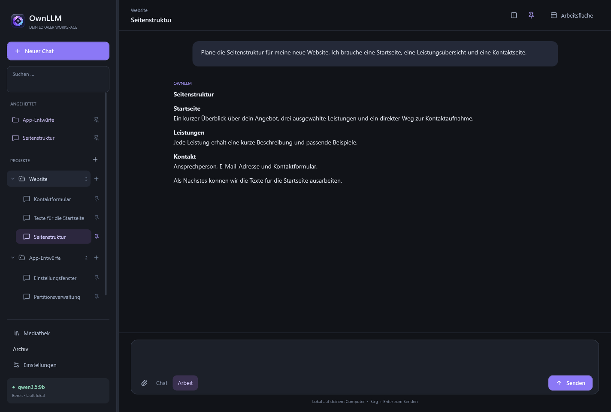
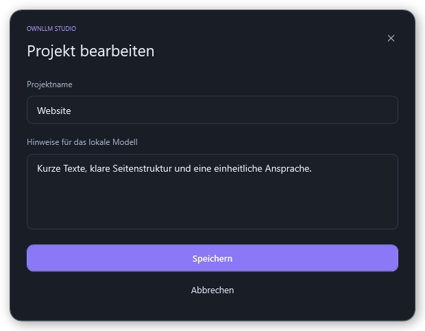
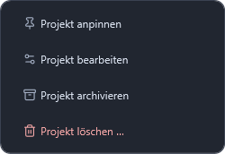
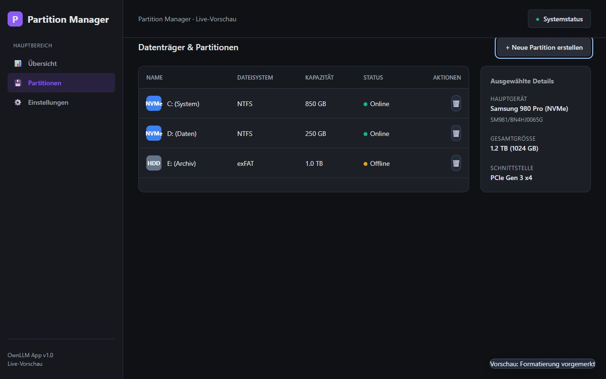
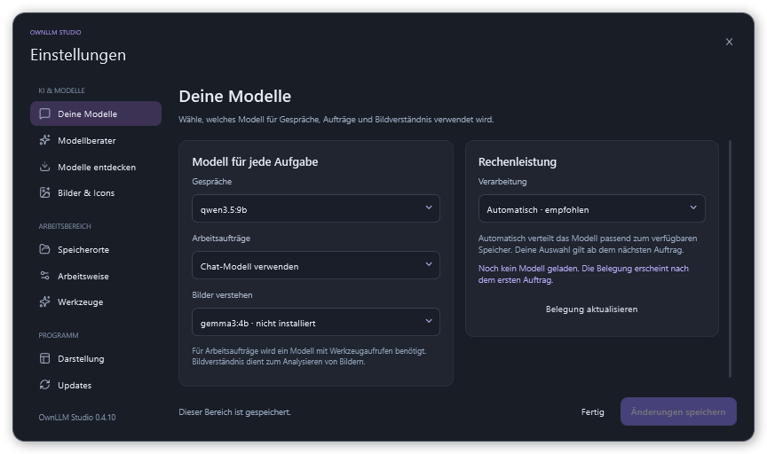
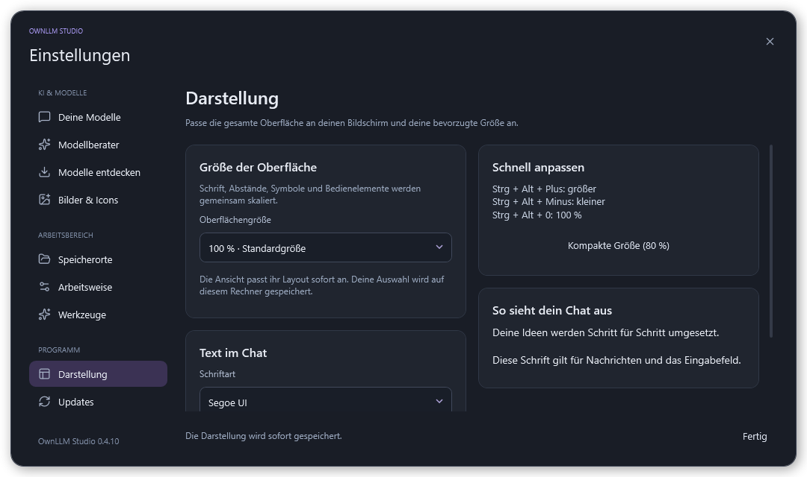

<h1 align="center">OwnLLM Studio</h1>

Chats, Projekte, App-Entwürfe und Bilder auf deinem Rechner.

<a href="https://github.com/ZUMBYTE-AppSolution/ownllm-release/releases/latest">Herunterladen</a> · <a href="CHANGELOG.md">Changelog</a> · <a href="https://github.com/ZUMBYTE-AppSolution/ownllm-release/issues">Fehler melden</a>

OwnLLM Studio ist ein lokaler Assistent für Windows. Du sammelst Gespräche in Projekten, arbeitest mit deinen Dateien und lässt dir App-Entwürfe als bedienbare Vorschau und Bilder aus einer Beschreibung erstellen. Das Sprachmodell läuft auf deinem Computer; Chats und Dateien werden in den von dir gewählten Ordnern gespeichert.

| Ausgabe | Download |
| --- | --- |
| Windows, 64 Bit | [Installer 0.4.10 herunterladen](https://github.com/ZUMBYTE-AppSolution/ownllm-release/releases/download/v0.4.10/OwnLLM-Studio-0.4.10-Windows-Setup.exe) |

Der Installer enthält die Programmdateien und bietet eine Desktopverknüpfung an. Beim ersten Start hilft dir ein Modellberater bei der Auswahl und Einrichtung passender Modelle. Visual Studio oder andere Entwicklungswerkzeuge brauchst du für die Nutzung nicht.

## Einblicke

### Projektchats und angeheftete Gespräche

### Projekte bearbeiten und verwalten

| Projekthinweise | Kontextmenü |
| --- | --- |
|  |  |

### App-Entwürfe ausprobieren

Die Bilder zeigen Beispielprojekte und einen lokal erzeugten App-Entwurf. Die Partitionsverwaltung ist eine Vorschau; sie verändert keine Datenträger.

## Das kannst du mit OwnLLM machen

| Bereich | Funktionen |
| --- | --- |
| **Chats und Projekte** | Gespräche unter Projektordnern sammeln, umbenennen, lange Verläufe automatisch verwalten und wichtige Chats oder Projekte anpinnen. Originalnachrichten bleiben nachlesbar. |
| **Chat und Arbeit** | Fragen besprechen oder einen Auftrag mit Planung, Umsetzung und anschließender Kontrolle bearbeiten lassen. |
| **App-Entwürfe** | Oberflächen mit Menüs, verschiedenen Ansichten und Dialogen erstellen und direkt ausprobieren. Jeder Chat hat eigene, einzeln schließbare Vorschau-Tabs. |
| **Bilder und App-Icons** | Das eingerichtete Bildmodell direkt aus dem Chat verwenden. Ein Klick auf das Vorschaubild öffnet die große Bildansicht. |
| **Sprachmodelle** | Der Berater berücksichtigt Rechner und Aufgaben. Gemma, Qwen und weitere Familien im Ollama- oder GGUF-Verzeichnis durchsuchen, Varianten prüfen und herunterladen. |
| **Dateien** | Dateien an Gespräche anhängen, in der Mediathek verwalten und erstellte Dokumente oder Projektdateien speichern. |
| **Archiv** | Chats und Projekte ausblenden und später wiederherstellen. Dauerhaftes Löschen wird vorher bestätigt. |
| **Eigene Speicherorte** | Ordner für Chats, Dateien, Projekte, Modelle und Cache selbst festlegen. |
| **Darstellung** | Die gesamte Windows-Oberfläche von 50 bis 200 Prozent skalieren. Chat-Schriftart und -größe separat wählen. Codeblöcke mit Farben und Kopierknopf. |
| **Recherche** | Quellen im Web suchen und deren Sachinformationen für Antworten und eigene Umsetzung verwenden. |

Seitenleiste, Gespräch und Vorschau lassen sich in der Breite verschieben. Während eines Auftrags zeigt die App die aktuelle Arbeitsphase an.

## Neu in 0.4.10

- Neu gestaltete, kompakte Einstellungen und echte Layout-Skalierung in elf Stufen von 50 bis 200 Prozent. Chat-Schriftart und Schriftgröße separat anpassen.
- Modellberater mit Fragenkatalog beim ersten Start und in den Einstellungen. Nach der Auswahl werden die empfohlenen Modelle heruntergeladen und eingerichtet.
- GGUF-Modelle von Hugging Face zusätzlich zum Ollama-Verzeichnis, inklusive Varianten, Teildateien und geprüfter Downloads.
- Eigene Arbeitsfläche pro Chat mit einzeln schließbaren Tabs, Codefarben mit Kopierknopf, nächste Schritte als Auswahl und eine einzeilige farbige Statusanzeige.
- Webrecherche, umbenennbare Chats und Projekte sowie Fehlermeldungen mit prüfbarem, bereinigtem Gesprächskontext.
- Verbesserte Mockup-Reparaturen, projektübergreifende Mediathek und behobene Gemma-Einstellungsfehler.

Die neuen Einstellungsbilder stammen aus einer getrennten Testinstanz mit Beispieldaten.

[Ausführlicher Changelog](CHANGELOG.md)

## Installation und erster Start

1. Den Windows-Installer herunterladen und öffnen.
2. Den Programmordner wählen. Unter **Alle Speicherorte** kannst du die Datenordner einzeln festlegen.
3. Die Desktopverknüpfung auswählen und **OwnLLM starten** anklicken.
4. Im Modellberater die gewünschten Aufgaben und Prioritäten auswählen, die Empfehlung prüfen und **Herunterladen und einrichten** anklicken.
5. Nach der Einrichtung ein Projekt oder einen neuen Chat anlegen. Der Berater bleibt unter **Einstellungen → Modellberater** erreichbar.

Das Sprachmodell benötigt zusätzlichen Speicherplatz. Die Qualität und Geschwindigkeit der Antworten hängen vom Modell und deinem Rechner ab. Für die Live-Vorschau wird [Microsoft Edge WebView2](https://developer.microsoft.com/microsoft-edge/webview2/) benötigt.

## Updates

Unter **Einstellungen → Updates** kannst du nach einer neuen Version suchen, sie herunterladen und mit **Installieren und neu starten** übernehmen. Dafür brauchst du kein GitHub-Konto. Die gewählten Speicherorte sowie vorhandene Chats, Projekte und Modelle bleiben erhalten.

Bei einem manuellen Update OwnLLM zuerst über das Symbol im Infobereich beenden und den neuen Installer mit dem bisherigen Programmordner ausführen.

## Hinweise zur aktuellen Version

OwnLLM Studio befindet sich noch in Entwicklung. Der Windows-Installer ist derzeit nicht digital signiert.

Beim Löschen eines Chats bleiben seine Dateien im Projekt erhalten. Beim Entfernen eines Projekts werden dessen Chats und Mediathek-Einträge gelöscht; die Dateien bleiben in ihren bisherigen Ordnern auf dem Rechner.

## Fragen oder Fehler?

[Fehler melden](https://github.com/ZUMBYTE-AppSolution/ownllm-release/issues) · [Alle Downloads](https://github.com/ZUMBYTE-AppSolution/ownllm-release/releases) · [Zumbyte – AppSolution](https://www.zumbyte.de)

Nenne bei einem Fehler bitte die verwendete Version und die Schritte, bei denen er auftritt.

© 2026 Zumbyte AppSolution · [Impressum](https://www.zumbyte.de/impressum/) · [Datenschutz auf zumbyte.de](https://www.zumbyte.de/datenschutz/)
